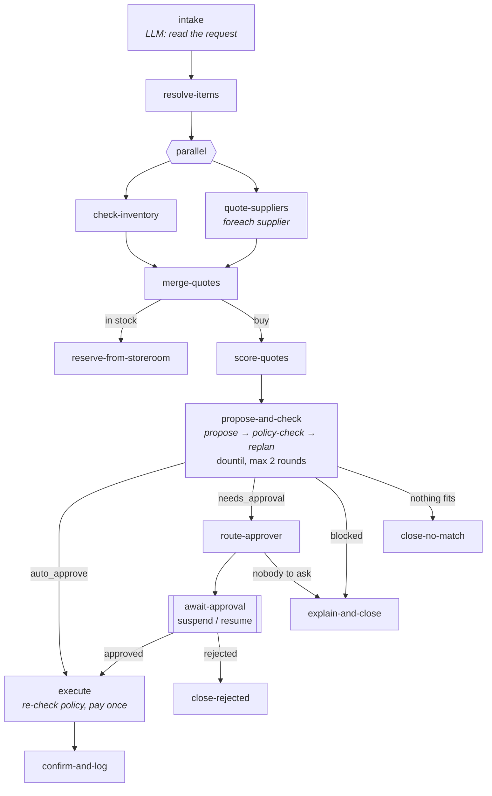
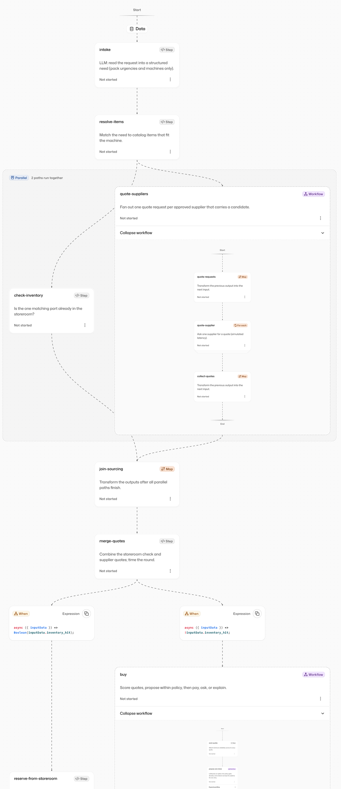

# CartKeeper on Mastra

The CartKeeper purchase graph, ported from LangGraph (Python, `../backend`) to a
Mastra workflow in TypeScript. Same packs, same policy, same numbers. The Python
version stays as the reference.

## Built with Mastra

**[Read the writeup](WRITEUP.md)**: what mapped cleanly from LangGraph, what didn't, and what the HITL
evals caught. Draft Mastra issues with standalone repros are in [`issues/`](issues/).

### The workflow



The model does exactly two things: read the request into a need (`intake`) and pick one option id
(`propose`). Everything else is code. Prices come from the catalog, the policy gate decides, and
`execute` re-checks policy before it pays with an idempotency key.



*The sourcing half of the workflow in Mastra Studio (`npm run dev`).*

### Eval results

30 labeled requests, Sonnet vs Haiku, 3 runs each, Opus as judge. 95% bootstrap intervals, resampling
items. Full report: [`evals/results/latest.md`](evals/results/latest.md).

| Scorer | Sonnet | Haiku |
| --- | --- | --- |
| HITL invariants (from the trace) | 100% | 100% |
| Decision path | 100% | 100% |
| Supplier choice under line-down | 100% | 100% |
| Intake accuracy | 100% | 97.5% [94.2, 100] |
| Approval card meets every criterion (LLM judge) | 55.6% [33.3, 77.8] | 41.7% [19.4, 63.9] |

The judge agreed with hand labels on 9 of 10 calibration cards. Most approval-card misses were
explanations that cited internal data the approver can't see; those are fixed but not yet
re-measured (see [the writeup](WRITEUP.md#what-the-hitl-evals-caught)).

## Status

- **Phase 0 (done):** the deterministic core, with no LLM in it.
  - `src/core/packs.ts` loads `../packs/<pack>` with strict zod schemas plus the
    same cross-file checks as `packs.py`.
  - `src/core/score.ts` has the CartLens supplier scores with shrinkage toward the pooled rate.
  - `src/core/policy.ts` is the policy gate. The model proposes; this decides.
  - `src/core/history.ts` aggregates order history into the inputs for scoring.
- **Phase 1 (done):** the purchase workflow, in `src/purchase/`.
  - `workflow.ts` maps each LangGraph node to a Mastra step (the diagram is at the top of the file).
    - Supplier quotes fan out in `.parallel()` with a `.foreach()`.
    - Propose, policy check and replan form a nested workflow looped by `.dountil()`, at most two rounds.
    - The outcomes are a `.branch()`.
    - The approval wait is a `suspend()` with `suspendSchema` and `resumeSchema`.
  - `steps.ts` is the node logic, ported line by line from `nodes.py`.
  - `model.ts` holds the only two model calls: read a request into a Need, and pick one option id. Neither
    schema can carry a price, a total or a decision. In production these go through the
    `intake-agent` and `propose-agent` (no tools, structured output); tests use a fake.
  - `service.ts` is start / decide / snapshot. The request id is the run id, and every view is read
    back from storage, so a paused request looks the same after a restart.
  - `execute` re-checks policy before paying and pays with the idempotency key `ck-<runId>-execute`.
- **Phase 2 (done):** the FastAPI contract as Mastra custom routes, in `src/api/routes.ts`.
  - `POST /requests`, `GET /requests/:id`, `POST /requests/:id/decision` and `GET /approvals`, with
    the same `X-User-Id` demo users, visibility rules, approver checks, status codes and
    `{"detail": ...}` errors.
  - `GET /approvals` reads the stored suspended runs, so an approver's inbox survives a restart.
  - A per-request lock makes a double click resume once, and the payment idempotency key backs it up.
  - One difference: `/health` is Mastra's built-in route and answers `{"success": true}`.
  - Studio (`npm run dev`) shows the run fan out, pause and resume.
- **Phase 3 (done):** parity with the Python backend, checked two ways.
  - Unit level: `test/parity.test.ts` (scores and policy, about 700 cases).
  - Behavior level: `test/behavior.test.ts` runs 17 shared scenarios (`test/fixtures/scenarios.json`)
    through both frameworks with the same fake model. It requires identical outcomes: status,
    options and scores, proposal, policy result, replan, approver, payment, message, which model
    calls ran, and what reached the ledger. The scenarios cover every behavior in the plan:
    approval tiers, storeroom hit, blocked then replan then explain, rejection, and policy changing
    during the pause.
  - The restart and resume-twice tests are in `test/workflow/durable.test.ts`.
- **Phase 4 (done):** tracing, in `src/mastra/observability.ts`.
  - One trace per request: every step, both agent runs and their model calls, the pause and the
    resume.
  - Traces are tagged with `request_id`, `requester_id`, and on resume `approval` / `decided_by`.
  - They always go to Mastra storage (Studio's Observability tab), and to Langfuse when
    `LANGFUSE_PUBLIC_KEY` and `LANGFUSE_SECRET_KEY` are set.
  - `test/workflow/tracing.test.ts` checks the trace stays single across suspend and resume, also
    when the resume runs in a new Mastra instance after a restart.
  - Porting notes and rough edges for the writeup are in `NOTES.md`.
- **Phase 5 (done):** evals, in `src/evals/`. Results above; raw runs in `evals/results/`.
  - `dataset.ts` has 30 labeled requests: line-down, storeroom, approval tiers, rejection, budget
    blocks, unapproved suppliers, missing approvers, stale approvals and ambiguous requests. Each
    is labeled with the need, first policy decision, approver, replan and final status. They are
    stored as a Mastra dataset.
  - `runner.ts` runs each item isolated (its own ledger, payments, storage and trace) and plays the
    approver, including spend that lands during the wait.
  - `scorers.ts` has five scorers:
    - `intake-accuracy` (code)
    - `supplier-choice` (code: under line_down, the most reliable offered supplier)
    - `hitl-invariants` (code, read from the trace: paused when required, never paid without
      approval, honored rejection, re-checked after the wait, replanned at most once, paid at most
      once). Policy is recomputed independently from the pack, not read from the run.
    - `decision-path` (code)
    - `approver-explanation` (Mastra's rubric judge on the approval card an owner sees)
  - `experiment.ts` runs each model several times as Mastra experiments (visible and comparable in
    Studio). It reports a 95% bootstrap interval per scorer, resampling items, and the judge's
    agreement with 10 hand-labeled calibration cards (`calibration.ts`).
  - The tests check the evals themselves:
    - an oracle model scores 1.0 on every code scorer, which validates the labels
    - a cheapest-first model and a sloppy reader score lower on the right scorers
    - deliberately broken runs trip each HITL invariant
  - `evals/pipeline-check.md` is a scripted-model run showing the report format. It is not model
    results.
- **Phase 6 (done):** this "Built with Mastra" section, [`WRITEUP.md`](WRITEUP.md), and the draft Mastra
  issues in [`issues/`](issues/), each checked against a standalone repro.

## Parity with Python

`test/behavior.test.ts` checks whole runs against the Python graph (see Phase 3).
`test/parity.test.ts` checks that the TS port returns exactly what the Python
code returns, byte for byte, including reason strings and rounding. The
reference outputs come from Python:

```bash
npm run parity      # re-export both fixtures from Python; needs the backend's Python deps
```

That script also writes `packs/<pack>/seed_history.json`, the seed order history
as plain rows, so the TS side doesn't have to replicate Python's RNG. Run it
again whenever `score.py`, `policy.py` or the pack's seed history changes.

`src/core/pyfmt.ts` holds the rounding helpers. Python rounds exact ties to
even, and JS `toFixed` rounds them up.

## Storage

Paused runs live in Mastra storage. With `DATABASE_URL` set (Supabase: use the Session pooler URL)
that is Postgres. Without it, it is a local LibSQL file. Budgets, members and orders are still in
memory, as in the Python Day 2 backend.

`test/workflow/durable.test.ts` pauses a request, closes the storage, then approves it from a new
Mastra instance with a new connection. It always runs on LibSQL, and also on Postgres when
`CARTKEEPER_TEST_DATABASE_URL` is set.

## Trying the API

```bash
curl -X POST localhost:4111/requests -H 'content-type: application/json' -H 'X-User-Id: u-tech-1' \
  -d '{"raw_request": "Replace drive motor on loom L-03"}'
```

```bash
curl localhost:4111/approvals -H 'X-User-Id: u-mm-1'
```

```bash
curl -X POST localhost:4111/requests/<id>/decision -H 'content-type: application/json' \
  -H 'X-User-Id: u-mm-1' -d '{"approval": "approved"}'
```

Demo users: `u-tech-1` (requester), `u-mm-1` (maintenance manager), `u-owner-1` (owner), `u-fin-1` (finance).

## Evals

```bash
npm run evals                                              # sonnet and haiku, 3 runs each, opus as judge
```

```bash
npm run evals -- --models oracle,cheapest,sloppy --no-judge   # scripted models, no API calls
```

Real runs need `CARTKEEPER_ANTHROPIC_API_KEY`. The report goes to `evals/results/latest.md`, with the
raw numbers in a JSON file beside it.

## Commands

```bash
npm install
npm test            # vitest
npm run typecheck
npm run dev         # Studio at http://localhost:4111 (needs CARTKEEPER_ANTHROPIC_API_KEY to run requests)
```
